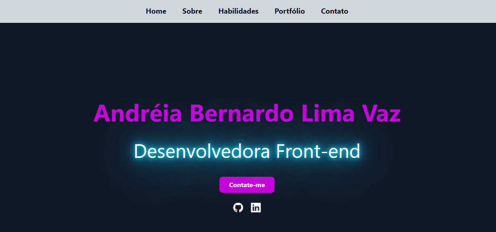

# Portfólio pessoal



Este projeto é um portfólio pessoal desenvolvido em React + TypeScript com Vite. A interface apresenta uma apresentação profissional, habilidades, projetos e informações de contato em um layout moderno e responsivo.

## Tecnologias utilizadas

- React
- TypeScript
- Vite
- Tailwind CSS
- react-slick
- slick-carousel

## Funcionalidades

- Seção inicial com apresentação pessoal
- Navegação por anchors
- Área de sobre mim
- Cards de habilidades
- Galeria de projetos com carrossel
- Seção de contato
- Layout visual moderno com responsividade

## Pré-requisitos

Antes de iniciar, verifique se você possui instalado:

- Node.js 18+
- npm ou yarn

## Instalação

1. Clone o repositório:

```bash
git clone <url-do-repositorio>
cd portfolio1
```

2. Instale as dependências:

```bash
npm install
```

## Como executar

### Desenvolvimento

```bash
npm run dev
```

A aplicação será aberta em modo de desenvolvimento, geralmente em:

```bash
http://localhost:5173
```

### Build de produção

```bash
npm run build
```

### Preview da build

```bash
npm run preview
```

## Scripts disponíveis

```bash
npm run dev
npm run build
npm run lint
npm run preview
```

## Estrutura do projeto

```bash
portfolio1/
├── public/
│   └── image/
├── src/
│   ├── App.tsx
│   ├── index.css
│   ├── main.tsx
│   └── assets/
├── index.html
├── package.json
├── tsconfig.json
├── vite.config.ts
├── eslint.config.js
└── README.md
```

## Observações

Este portfólio foi pensado como uma vitrine profissional para apresentar projetos, tecnologias e informações de contato. O design usa imagens e destaque visual para destacar a identidade da desenvolvedora.

## Autor

Andréia Bernardo Lima Vaz

## Licença

Este projeto está disponível para uso pessoal e estudo. Caso queira reutilizar, ajuste os textos, imagens e links de acordo com sua necessidade.
